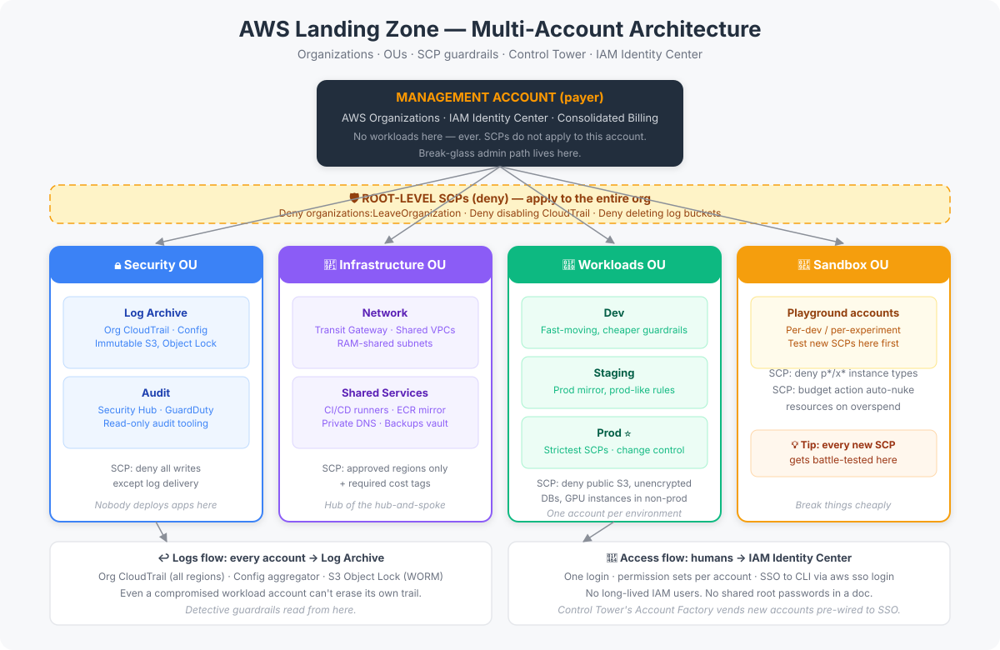

# AWS Landing Zone Guide


> One AWS account is a garage. Ten AWS accounts with no rules is a parking lot on fire.
> A **landing zone** is the planned city: zoned districts, shared roads, and traffic laws —
> so every team can build fast without burning the whole thing down.

## TL;DR

A landing zone is a **well-architected, multi-account AWS foundation** that gives every
workload a safe place to land. Instead of piling everything into one account, you split
work across purpose-built accounts (prod, dev, security, networking…) organized in
**Organizational Units (OUs)**, guardrailed by **Service Control Policies (SCPs)**,
bootstrapped by **AWS Control Tower**, and accessed centrally via **IAM Identity Center**.
The result: blast-radius isolation, clean cost attribution, and security baselines that
apply themselves to every new account — including the ones created at 2 AM on a Friday.

## The Core Idea

| Single account (the trap) | Landing zone (the plan) |
|---|---|
| One blast radius for everything | Prod, dev, and experiments isolated per account |
| "Who spent $4,000 on EC2?" — shrug | Cost attributed per account, per team, per OU |
| Security rules = tribal knowledge | SCPs + guardrails enforce baselines automatically |
| New project = copy-paste IAM chaos | Account vending machine stamps out compliant accounts |
| Audit = archaeology | Org-wide CloudTrail + Config in a locked log account |

## Architecture



The diagram shows the canonical layout:

1. **Management account** — the payer. Hosts AWS Organizations, IAM Identity Center,
   and billing. It runs *nothing* customer-facing.
2. **Security OU** — `Log Archive` (immutable org-wide CloudTrail + Config logs) and
   `Audit` (read-only security tooling). Nobody deploys apps here.
3. **Infrastructure OU** — shared networking (`Network` account: Transit Gateway, shared
   VPCs) and shared services (`Shared Services`: CI/CD runners, ECR mirrors, DNS).
4. **Workloads OU** — one account per environment: `Dev`, `Staging`, `Prod`.
   SCPs here are the strictest.
5. **Sandbox OU** — personal playgrounds with auto-cleanup guardrails.

Guardrails flow **downward**: an SCP attached to the Workloads OU applies to Dev,
Staging, and Prod at once. Deny rules at the root apply to *everything*.

## Building Blocks

| Component | What it does | Why it matters |
|---|---|---|
| **AWS Organizations** | Groups accounts into OUs, consolidated billing | The skeleton everything hangs on |
| **Service Control Policies (SCPs)** | Permission *ceilings* for OUs/accounts | Guardrails that even admins can't cross |
| **AWS Control Tower** | Opinionated setup: OUs, accounts, guardrails, dashboards | Landing zone in ~30 minutes instead of 3 weeks |
| **IAM Identity Center (SSO)** | One login → permission sets per account | No more 14 IAM users with `AdministratorAccess` |
| **Org CloudTrail + Config** | Centralized audit trail and compliance recording | The security team's single pane of glass |
| **Account Factory** | Templated account provisioning | Every new account is born compliant |

### Organizations vs Control Tower vs Landing Zone Accelerator

| | AWS Organizations | AWS Control Tower | Landing Zone Accelerator (LZA) |
|---|---|---|---|
| Scope | DIY primitives (OUs, SCPs, billing) | Managed landing zone setup | Code-defined, enterprise-grade baseline |
| Setup effort | High — you design everything | Low — opinionated defaults | Medium — YAML config, full control |
| Guardrails | You write every SCP | 30+ preventive/detective/proactive included | Fully customizable as code |
| Best for | Learning the primitives | Teams wanting a solid start fast | Regulated / large orgs needing customization |
| Customization | Unlimited, manual | Some (via Account Factory customization) | Everything in Git |

> **Rule of thumb:** learn Organizations first, start real work with Control Tower,
> graduate to LZA when compliance lawyers start attending your standups.

## Guardrails: The Three Flavors

Control Tower ships guardrails in three enforcement modes:

- **Preventive** — implemented as SCPs. *Example: "Deny disabling CloudTrail."*
  The action is blocked before it happens. Strongest, use for non-negotiables.
- **Detective** — implemented as AWS Config rules. *Example: "Alert if an S3 bucket
  becomes public."* Flags drift; doesn't stop it.
- **Proactive** — checked at deploy time via CloudFormation hooks.
  *Example: "Block a stack that creates an unencrypted RDS instance."*
  Catches violations before resources exist.

```jsonc
// A classic preventive guardrail: no one leaves the org, ever.
{
  "Version": "2012-10-17",
  "Statement": [{
    "Sid": "DenyLeavingOrg",
    "Effect": "Deny",
    "Action": "organizations:LeaveOrganization",
    "Resource": "*"
  }]
}
```

## Quick Start with Terraform

The full IaC for the OU + SCP skeleton lives in [`organizations.tf`](organizations.tf).
It provisions:

- The OU tree (Security / Infrastructure / Workloads / Sandbox)
- Three production SCPs: region restriction, required tags, deny-leaving-org
- Example member accounts wired to their OUs

```bash
# Never run this against an account you care about without a plan review.
terraform init
terraform plan -out=tfplan   # read it. twice.
terraform apply tfplan
```

> ⚠️ SCPs are **destructive by design** — a bad deny rule can lock you out of your own
> accounts. Always test SCPs on the Sandbox OU first, and keep a break-glass admin path
> outside SCP scope (the management account itself is not affected by SCPs).

## Common Pitfalls

1. **Putting workloads in the management account.** The payer account should be empty
   of workloads. One compromised app server = compromised billing for the whole org.
2. **SCPs as whitelists on day one.** Start with *deny* guardrails for known-bad actions
   (leaving org, disabling logs, public S3). Full allow-listing is a month-3 project.
3. **Forgetting the break-glass.** If an SCP denies `iam:*` broadly and you lose your
   Identity Center access, recovery is a support ticket. Keep an emergency root path
   documented and tested.
4. **One OU for everything.** OUs are free. `Workloads/Prod` vs `Workloads/Dev` lets
   you say "no EC2 in dev after hours" without touching prod.
5. **Skipping the Log Archive account.** Org CloudTrail in the same account as your apps
   is a log you can't trust. Ship logs to a locked, separate account on day one.

## Cost Angle

- Consolidated billing = volume discounts apply org-wide.
- Per-account cost allocation tags turn "the AWS bill" into "team A's bill".
- Sandbox OU with SCP `Deny` on expensive instance families (`p*`, `x*`) has saved
  more than one team from a surprise GPU bill.

## Quiz

Think you've got it? Five questions in [`quiz.md`](quiz.md) — answers collapsed,
no peeking. 🟩

## Further Reading

- AWS Well-Architected Framework — *Operational Excellence & Security pillars*
- AWS Control Tower documentation — guardrail reference
- `organizations.tf` in this repo — the OU/SCP skeleton as code
